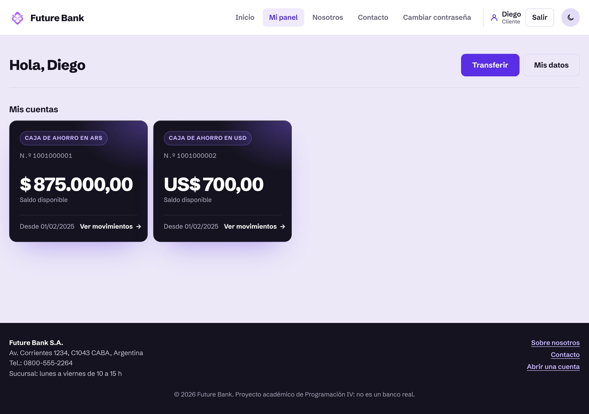
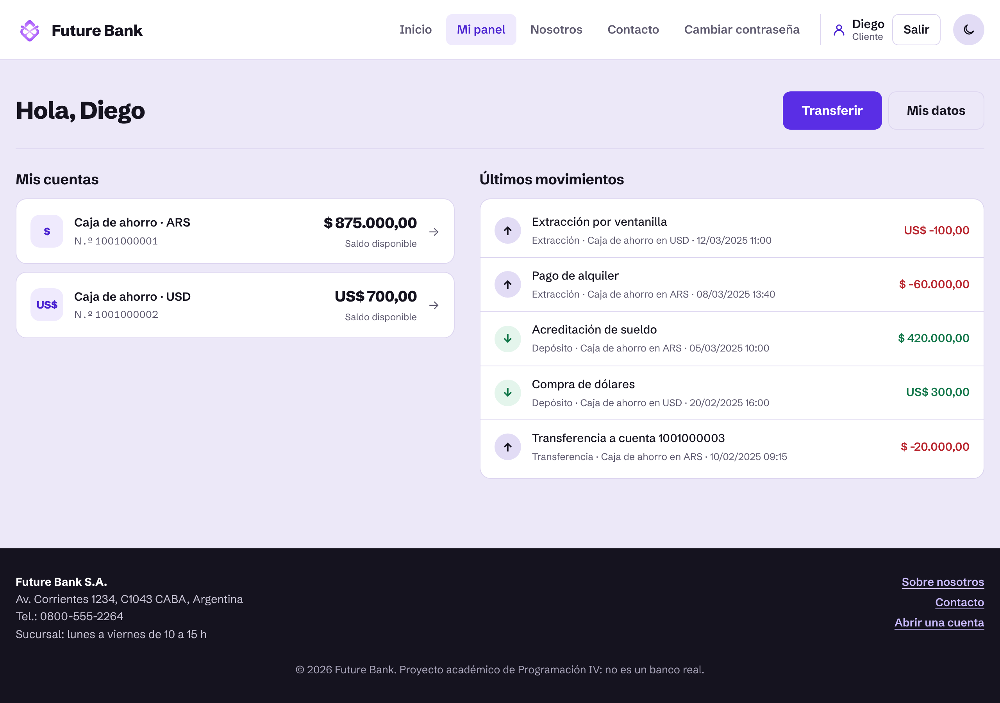
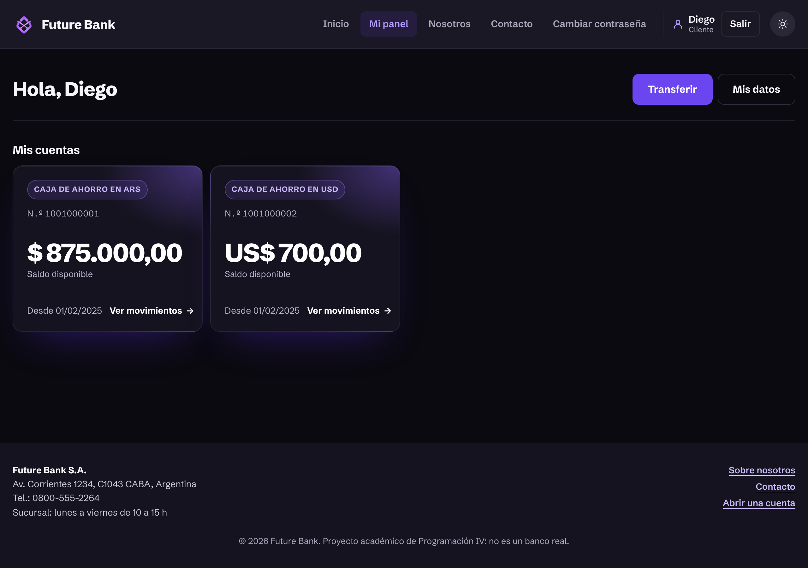
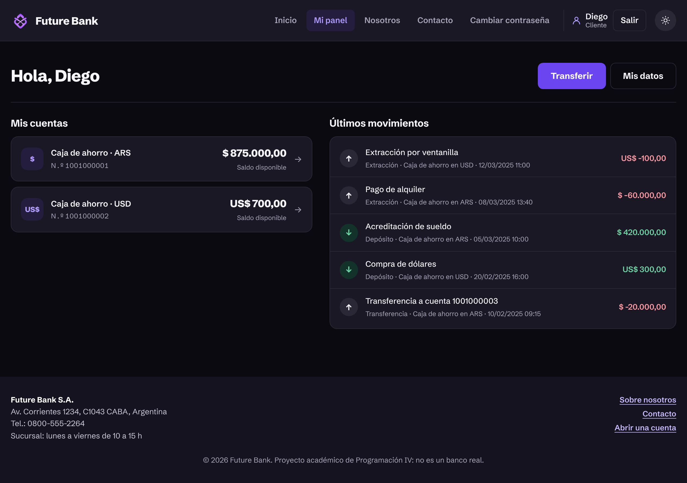
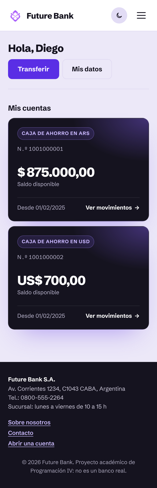
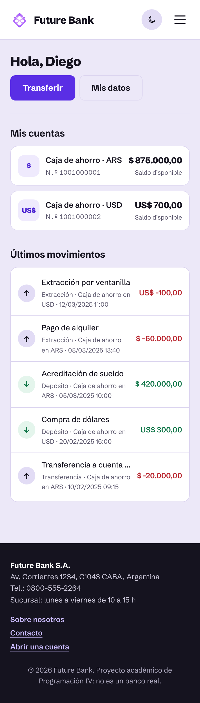

## Panel del cliente: cuentas compactas + últimos movimientos

### Qué cambia
- **Cuentas más livianas**: las tarjetas oscuras grandes pasan a filas compactas y clickeables (moneda, tipo, número y saldo). Toda la fila lleva a los movimientos de esa cuenta.
- **Últimos 5 movimientos**: nueva lista al lado de las cuentas con los últimos 5 movimientos de **todas** las cuentas del cliente, mezclados por fecha (ícono de entrada/salida, descripción, tipo, cuenta, fecha y monto con color).
- En celular se apila: primero las cuentas, después los movimientos.
- Las estadísticas de admin/operador conservan su estilo destacado; solo cambian las cuentas del cliente.

### Capturas

| | Antes | Después |
|---|---|---|
| Escritorio |  |  |
| Escritorio (oscuro) |  |  |
| Celular |  |  |

### Cómo probar
1. Entrar como `diego@mail.com` / `123456` (Clientes).
2. Ver *Mi panel*: 2 cuentas compactas y los últimos 5 movimientos de ambas.
3. Click en una cuenta → abre sus movimientos.

🤖 Generated with [Claude Code](https://claude.com/claude-code)

https://claude.ai/code/session_01XapQyhmkFkgCRAhD1LnVjc
